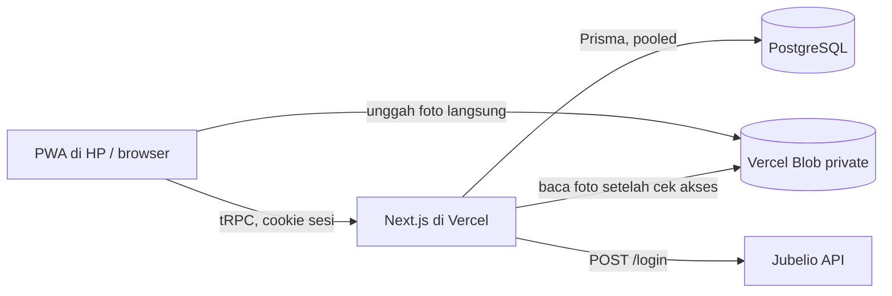
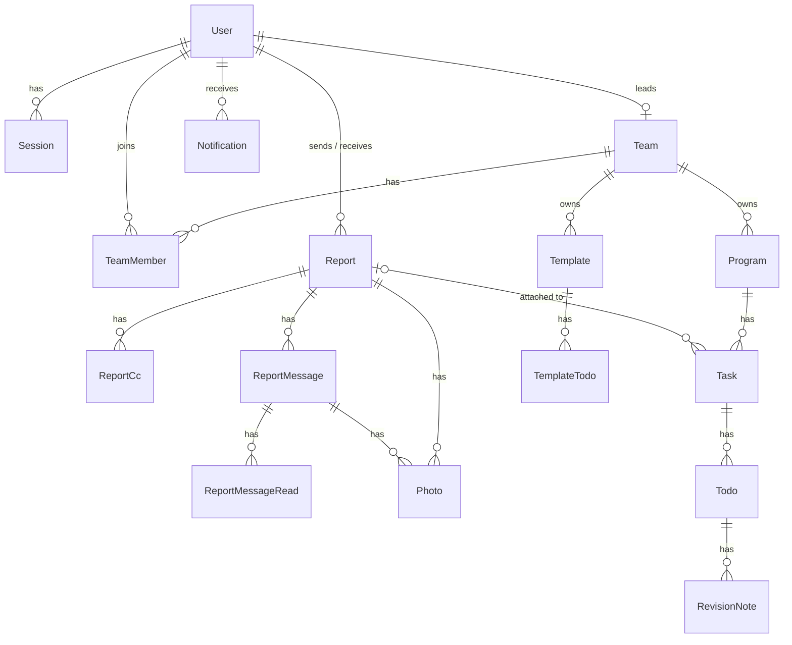

# Design & Architecture — SAFAR OPS 2

Versi 1.0, 5 November 2026. Acuan requirement: `docs/SRS.md`.

## 1. Peta halaman

Rute mengikuti 14 layar mockup. Modal dan lapisan (sheet, pilih, foto, toast, notifikasi) bukan rute.

| Rute | Layar mockup | Akses |
|---|---|---|
| `/login` | Baru | Publik |
| `/offline` | Baru | Publik |
| `/` | `vHome` | Semua |
| `/penugasan` | `vHub` | Semua |
| `/penugasan/laporan` | `vLapList` | Semua |
| `/penugasan/laporan/baru` | `vLapNew` | Semua |
| `/penugasan/laporan/[no]` | `vLapDetail` | Yang berhak melihat |
| `/penugasan/program` | `vPrgList` | Semua |
| `/penugasan/program/baru` | `vPrgNew` | Pemilik, leader |
| `/penugasan/program/[id]` | `vPrgDetail` | Sesuai visibilitas |
| `/penugasan/program/[id]/tugas/baru` | `vTgsNew` | Pemilik, leader tim |
| `/penugasan/tugas/[id]` | `vTgsDetail` | Sesuai visibilitas |
| `/penugasan/tim` | `vTim` | Pemilik |
| `/penugasan/tim/[id]` (`baru` untuk tambah) | `vTimEdit` | Pemilik |
| `/penugasan/template` | `vTpl` | Leader |
| `/penugasan/template/[id]` (`baru` untuk tambah) | `vTplEdit` | Leader |

## 2. Cara menjaga kesesuaian dengan mockup

1. Token `:root` mockup (terang dan gelap) disalin persis ke variabel CSS, lalu dihubungkan ke Tailwind dan shadcn/ui.
2. Komponen shadcn/ui diubah agar nilainya sama dengan class mockup (`.btn`, `.card`, `.pill`, `.sheet`, dan seterusnya), bukan sebaliknya.
3. Semua teks layar, toast, dan pesan error disalin dari mockup, termasuk format `PNG-XXX-00: pesan`.
4. Aturan bisnis mockup dipindahkan ke fungsi server dengan nama setara (`dueRank`, `progressOf`, `visibleTugas`, `canSeeLap`) dan diberi unit test.
5. Setiap layar lolos pemeriksaan NFR-01 sebelum status RTM menjadi Done.

CSS mockup yang tidak dipakai layar mana pun (`.vf`, `.doc`, `.lbl`, bagian Konsumen, Skenario uji) tidak dibawa.

## 3. Hosting

### 3.1 Perbandingan

| Aspek | Vercel + Neon + Vercel Blob | VPS (Node + PostgreSQL + disk) |
|---|---|---|
| Kecocokan Next.js | Sangat baik | Baik, perlu diatur manual |
| Deploy, SSL, preview per cabang | Otomatis | Diatur sendiri |
| Backup dan update server | Sebagian besar otomatis | Tanggung jawab tim |
| Biaya | Pro US$20/seat/bulan, ditambah database dan pemakaian | Biaya sewa VPS tetap |
| Risiko utama | Biaya tahunan melebihi add-on GajiHub | Perawatan server dan backup |

**Paket Hobby tidak dipakai.** Secara teknis aplikasi bisa berjalan, tetapi syarat Vercel menghitung proyek sebagai komersial jika ada yang dibayar untuk membuatnya, termasuk karyawan atau konsultan, walaupun aplikasinya internal. Hobby juga berhenti sampai 30 hari jika kuota terlampaui, antara lain 4 jam Active CPU dan 10 GB Fast Origin Transfer per bulan, serta tidak punya dukungan email.

**Rekomendasi: Vercel Pro**, dengan syarat biaya diterima. Aplikasi ini kecil dan tim tidak perlu merawat server. Kode dibuat tidak terikat Vercel: penyimpanan foto dan akses database lewat lapisan tersendiri, sehingga pindah ke VPS tetap mungkin.

### 3.2 Batasan Vercel yang memengaruhi rancangan

| Batasan | Penanganan |
|---|---|
| Filesystem tidak bisa dipakai menyimpan foto | Vercel Blob, store private |
| Body request function maksimal 4,5 MB | Foto dikompres di HP menjadi di bawah 1 MB, lalu diunggah lewat `POST /api/photos` yang menolak di atas 4 MB |
| Private Blob dibaca lewat function | Rute `/api/photos/[id]` sekaligus memeriksa hak akses (NFR-04) |
| Banyak koneksi dari serverless | Prisma memakai URL pooled; migrasi memakai URL direct |
| Server memakai UTC | Fungsi tanggal terpusat dengan Asia/Jakarta (NFR-06) |

Region function: Singapura (`sin1`). Region database dipilih sedekat mungkin, ketersediaan Singapura di Neon dicek saat setup.

## 4. Arsitektur



Monolith satu aplikasi Next.js. Tidak ada worker, queue, atau Redis karena tidak ada proses latar belakang dan chat tidak realtime.

### 4.1 Login

Trade-off: Auth.js Credentials lebih umum tetapi menambah lapisan untuk satu metode login. Sesi di database cukup sederhana dan bisa dicabut kapan saja. **Dipilih sesi database.**

1. Pengguna mengirim email dan password ke server ops2.
2. Server meneruskan ke `POST /login` Jubelio. Password tidak disimpan dan tidak masuk log.
3. Jubelio mengembalikan HTTP 500 berisi `code: "Invalid email or password"` untuk kredensial salah. Ini dipetakan ke PNG-AUT-01. Kegagalan lain menjadi PNG-AUT-02.
4. Server membuat atau memperbarui User, lalu membuat Session dan cookie httpOnly. Masa sesi 7 hari, diperpanjang selama aktif.
5. Token Jubelio milik karyawan tidak disimpan.

### 4.2 Daftar pengguna (risiko A-02)

Antarmuka `UserDirectory` memisahkan sumber data dari fitur:

| Opsi | Cara | Kelebihan | Kekurangan |
|---|---|---|---|
| A | Endpoint daftar pengguna Jubelio dengan akun sistem | Sesuai K-T16, semua nama langsung tersedia | Endpoint belum ditemukan |
| B | Pengguna tercatat saat pertama kali login | Tidak bergantung endpoint | Seseorang baru bisa dipilih setelah login sekali; nama bisa hanya berupa email |

Opsi A dipakai jika terbukti di Sprint 0. Jika tidak ada, opsi B dipakai dan dicatat di CHANGELOG. Saat ini kode memakai opsi B (`src/server/integrations/user-directory.ts`) sambil menunggu kepastian endpoint.

### 4.3 PWA opsi A

Trade-off: Serwist menyediakan banyak fitur cache yang tidak dipakai opsi A. Manifest bawaan Next.js dan service worker kecil yang ditulis sendiri lebih ringkas. **Dipilih yang ditulis sendiri.**

- `app/manifest.ts`: nama SAFAR OPS 2, `display: standalone`, warna tema oranye, ikon 192, 512, dan maskable.
- `public/sw.js`: cache `/_next/static`, ikon, dan `/offline`. Rute `/api/*` dan halaman selalu lewat jaringan.
- Muat ulang saat aplikasi kembali aktif, tanpa polling: TanStack Query untuk data di klien, `RefreshOnFocus` untuk halaman yang dirender di server.
- iOS tidak punya tombol install otomatis, jadi panduan "Tambahkan ke Layar Utama" masuk manual book.

### 4.4 Foto

Kompres di HP (`browser-image-compression`, maksimal 1 MB dan sisi terpanjang 1600 px) → `POST /api/photos` memeriksa isi berkas dan mengembalikan key → key dikirim bersama laporan atau pesan. Key hanya bisa dipakai pengunggahnya.

Trade-off: unggah langsung ke Blob mengurangi beban server, tetapi mengikat kode ke Vercel padahal hosting belum diputuskan. Foto sudah kecil setelah dikompres, jadi **dipilih unggah lewat server** dengan `src/server/integrations/photo-storage.ts` sebagai satu-satunya lapisan penyimpanan. Saat ini berkas disimpan di disk lokal; deploy ke Vercel butuh driver Blob di berkas itu, deploy ke VPS cukup mengatur `PHOTO_STORAGE_DIR`. Foto yang terunggah tetapi laporannya batal dikirim tertinggal sebagai berkas yatim dan belum dibersihkan otomatis. Berkas HEIC dari iPhone belum diuji di HP asli.

## 5. ERD

Nama kode memakai bahasa Inggris. Perbedaan dari usulan PRD bagian 12 dicatat di CHANGELOG no. 8, 10, dan 11.



| Tabel | Field utama | Aturan dan index |
|---|---|---|
| User | id, email, name, jubelioUserId?, isActive, createdAt | `email` unik. Pemilik dihitung dari konfigurasi, tidak disimpan |
| Session | id, userId, tokenHash, expiresAt | `tokenHash` unik |
| LoginAttempt | id, email, ip, success, createdAt | Index (`email`, `createdAt`) untuk pembatasan |
| Team | id, name, color, leaderId | `color` unik, `leaderId` unik (K-T20, K-T70 dijaga database) |
| TeamMember | teamId, userId | PK gabungan, index `userId` |
| Report | id, number, title, type, body, status, fromId, toId, rejectReason?, recipientOpenedAt?, createdAt | `number` unik; index `toId`, `fromId`, (`status`, `createdAt`) |
| ReportCounter | period (YYMM), lastSeq | PK `period`, naik secara atomik |
| ReportCc | reportId, userId | PK gabungan, index `userId` |
| ReportMessage | id, reportId, senderId?, body, isSystem, createdAt | Index (`reportId`, `createdAt`) |
| ReportMessageRead | messageId, userId, readAt | PK gabungan |
| Photo | id, reportId?, messageId?, blobPath, sortOrder | Dua FK nullable, tepat satu terisi (CHECK), bukan ownerType |
| Program | id, name, teamId, status, createdById, createdAt | Index (`teamId`, `status`) |
| Task | id, programId, name, reportId?, qcApprovedAt?, qcApprovedById?, deletedAt?, deletedById?, createdById, createdAt | Tertutup jika `qcApprovedAt` terisi. Terhapus jika `deletedAt` terisi; semua query Task menyaring baris terhapus lewat satu helper. Index `programId`, `reportId` |
| Todo | id, taskId, sortOrder, name, picId, dueDate (date), instruction?, isDone, revisionCount, needsReassign | Index `taskId`, (`picId`, `isDone`) |
| RevisionNote | id, todoId, note, createdById, createdAt | Index `todoId` |
| Template | id, teamId, name | Index `teamId` |
| TemplateTodo | id, templateId, sortOrder, name | Index `templateId` |
| Notification | id, userId, category, text, targetType, targetId, createdAt, readAt? | Index (`userId`, `readAt`). Batalkan = `readAt` dikosongkan |
| ActivityLog | id, entityType, entityId, text, actorId?, createdAt | Index (`entityType`, `entityId`) |

## 6. Kontrak API (tRPC)

Semua prosedur butuh sesi. Input divalidasi Zod. Error membawa kode PNG. Halaman membaca data langsung lewat service di server, jadi tRPC hanya dipakai untuk perubahan data dan pembacaan dari klien.

| Router | Prosedur | Akses |
|---|---|---|
| `auth` | `login`, `logout`, `me` | Publik untuk `login` |
| `team` | `create`, `update` | Pemilik |
| `report` | `list`, `create`, `start`, `reject`, `finish`, `forward`, `addCc`, `sendMessage`, `markOpened` | Sesuai PRD 4 |
| `program` | `create`, `close`, `cancel` | Buat: pemilik, leader tim. Tutup dan batal: leader tim |
| `task` | `create`, `remove` | Buat dan hapus: pemilik, leader tim |
| `todo` | `add`, `update`, `move`, `remove`, `toggle` | `toggle`: PIC; lainnya: pemilik, leader tim |
| `qc` | `approve`, `returnForRevision` | Leader tim |
| `template` | `create`, `update`, `remove` | Leader tim |
| `notification` | `list`, `open`, `markRead`, `undo`, `clearAll` | Pemilik data |

Rute non-tRPC: `POST /api/photos` dan `GET /api/photos/[id]`.

## 7. Struktur folder

```
prisma/                 schema dan migrasi
public/                 ikon, sw.js
src/app/                rute (bagian 1)
src/components/ui/      shadcn/ui yang disesuaikan
src/components/         komponen layar
src/config/             owners.ts, team-palette.ts, error-codes.ts
src/server/routers/     router tRPC
src/server/services/    aturan bisnis, notifikasi, activity log
src/server/integrations/ jubelio, photo-storage, user-directory
src/lib/                date (Asia/Jakarta), initials, format
```
